<!-- ===== PINNED / POPULAR PROJECTS ===================== -->
 

<!-- ===== SOCIAL BADGES ===== -->
 

&nbsp;&nbsp;&nbsp;&nbsp;&nbsp;&nbsp;&nbsp;&nbsp;&nbsp;&nbsp;

<!-- ===== END SOCIAL BADGES ===== -->
<!-- =================================== -->

<picture>
<source media="(prefers-color-scheme: dark)" srcset="https://raw.githubusercontent.com/Balram-1/Balram-1/output/github-contribution-grid-snake-dark.svg" />
<source media="(prefers-color-scheme: dark)" srcset="https://raw.githubusercontent.com/Balram-1/Balram-1/output/github-contribution-grid-snake.svg" />

</picture>

